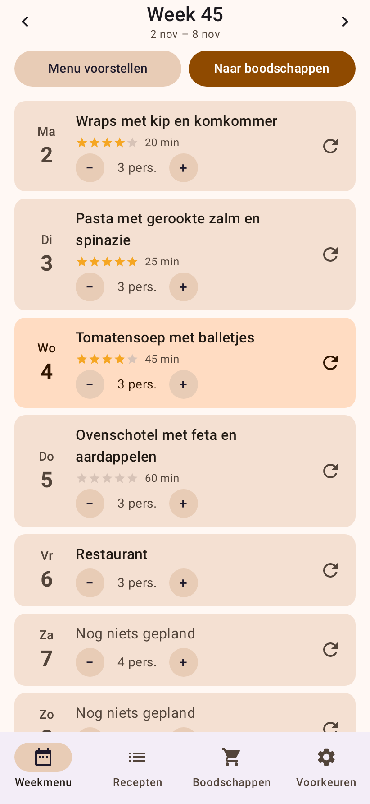
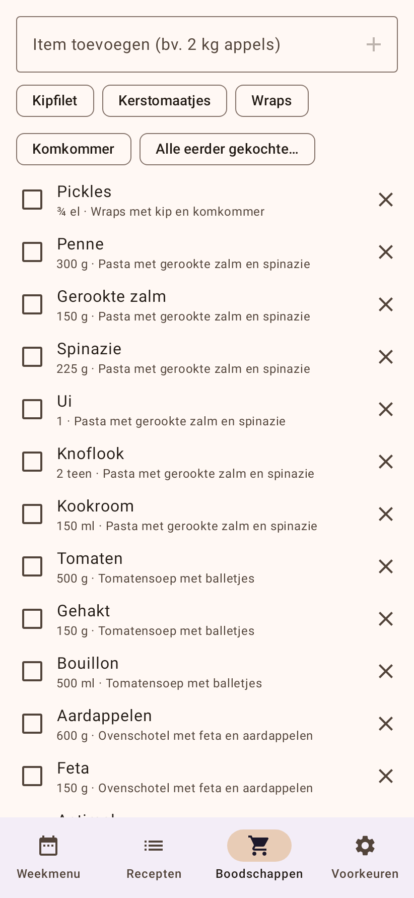
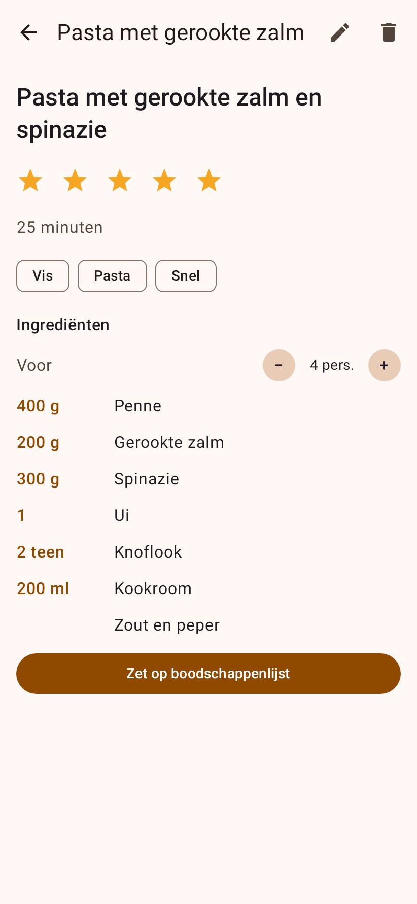
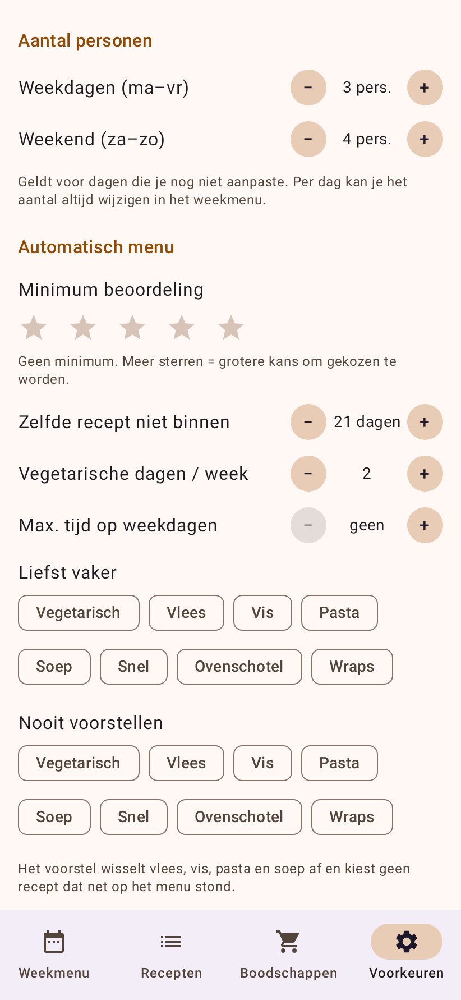

# Weekmenu – Android-app

Een eenvoudige app om per dag **één maaltijd** te plannen, met een slimme boodschappenlijst.
Alle gegevens blijven lokaal op je telefoon (geen account, geen server).

| Weekmenu | Boodschappen | Recept | Voorkeuren |
|---|---|---|---|
|  |  |  |  |

*(Schermafbeeldingen gegenereerd met Robolectric, dus het uiterlijk op een echt toestel kan licht verschillen.)*

## Functies

**Weekmenu**
- Eén maaltijd per dag. De planningsweek loopt van **zaterdag tot en met vrijdag** (je winkeldag is de eerste dag);
  blader per week met ◀ ▶, tik op de titel om naar de huidige week te springen.
- Aantal personen per dag: standaard **3 op weekdagen** en **4 op za/zo**, per dag aan te passen met − / +
  (de standaardwaarden zijn in *Voorkeuren* te wijzigen).
- Kies een recept uit je verzameling of typ een eigen invoer ("Restaurant", "Restjes", …).
- **Menu voorstellen**: vult lege dagen (of de hele week) automatisch in. Met ↻ gooi je één dag opnieuw.
  Alles is ongedaan te maken via de melding onderaan.

**Recepten**
- **Toevoegen via link**: plak de URL (de app plakt automatisch een gekopieerde link voor je in) of
  gebruik **Delen → Weekmenu** vanuit je browser. Titel, foto, aantal personen, bereidingstijd en ingrediënten
  worden ingelezen uit de schema.org/Recipe-gegevens die vrijwel alle receptensites bevatten.
  Je controleert het resultaat nog voor je het bewaart.
- Lukt het inlezen niet (site blokkeert apps of heeft geen receptgegevens)? Dan vul je het recept zelf in.
- **Beoordeling met 1–5 sterren** (tik nogmaals op dezelfde ster om te wissen).
- Tags (Vegetarisch, Vlees, Vis, Pasta, Soep, Snel, …) worden uit de ingrediënten geraden en zijn aan te passen.
- Ingrediënten schalen mee met het aantal personen.

**Boodschappenlijst** (zoals Google Keep: afvinkbaar, afgevinkt onderaan inklapbaar)
- *Naar boodschappen* in het weekmenu zet de ingrediënten van de week op de lijst, **omgerekend naar het aantal
  personen per dag** en samengevoegd (2 × ui → één regel, 800 g + 1 kg → 1,8 kg).
  Dezelfde maaltijd wordt nooit dubbel toegevoegd. Zout, peper en water worden overgeslagen (instelbaar).
- Afrondingen die je kan gebruiken: blikken/stuks naar boven, grammen op 5, lepels als ¼ ½ ¾.
- **Handmatig toevoegen**, ook met hoeveelheid: `2 kg appels`.
- **Afgevinkte items worden onthouden**: tik een suggestie aan, of open *Alle eerder gekochte…*
  (doorzoekbaar, meest gekocht eerst) om iets met één tik terug op de lijst te zetten.
  *Lijst opruimen* wist de afgevinkte items van de lijst, maar ze blijven in je historiek.

**Automatisch menu op basis van voorkeuren** (tab *Voorkeuren*)
- Meer sterren = grotere kans om gekozen te worden (niet-beoordeeld telt als 3 sterren).
- Minimum aantal sterren, tags die je liever vaker/nooit wil.
- Zelfde recept niet binnen X dagen opnieuw (ook rekening houdend met vorige/volgende week).
- Streefaantal vegetarische dagen per week.
- Maximale bereidingstijd op weekdagen.
- Wisselt vlees / vis / pasta / soep af (niet twee dagen na elkaar).

## Installeren op je telefoon

1. Elke push naar `main` of een `claude/**`-branch bouwt via GitHub Actions een APK
   (workflow *Weekmenu APK*). Open op je telefoon:
   `https://github.com/rimeco/rimeco.github.io/releases/tag/weekmenu-latest` en download **Weekmenu.apk**.
2. Open het bestand en sta "Installeren van onbekende bronnen" toe voor je browser.
3. Nieuwe versies installeer je gewoon over de vorige: de APK is steeds met dezelfde sleutel ondertekend,
   dus je recepten en lijsten blijven bewaard.

Zelf bouwen (JDK 17 + Android SDK 35):

```bash
cd weekmenu
./gradlew testDebugUnitTest      # tests
./gradlew assembleRelease        # app/build/outputs/apk/release/app-release.apk
```

## Opbouw

Kotlin + Jetpack Compose (Material 3), minSdk 26 (Android 8+).

| Map | Inhoud |
|---|---|
| `data/` | datamodel, JSON-opslag in één bestand (`filesDir/weekmenu.json`), tags |
| `logic/` | `RecipeImporter` (JSON-LD), `IngredientParser`, `ShoppingBuilder`, `MenuPlanner`, `Units` – puur Kotlin, volledig getest |
| `ui/` | schermen en `AppViewModel` |

Tests: `./gradlew testDebugUnitTest` (parser, import, planner, boodschappenlijst en een UI-rooktest op de JVM via Robolectric).

## Bekende beperkingen

- Sommige sites (bv. met bot-bescherming) weigeren het ophalen van de pagina; dan kan je het recept handmatig invullen.
  Pagina's zonder schema.org-receptgegevens leveren enkel titel en foto op.
- Back-up/synchronisatie tussen toestellen zit er (nog) niet in. Android-back-up van de app-gegevens staat wel aan.
- De APK is ondertekend met een in de repo aanwezige sleutel (`app/debug.keystore`) – prima voor eigen gebruik,
  niet voor publicatie in de Play Store.
